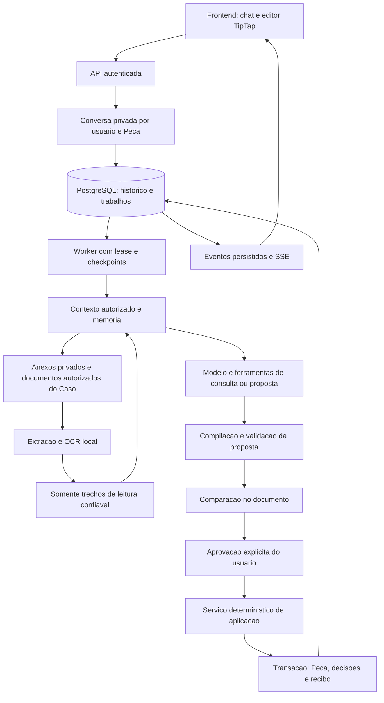
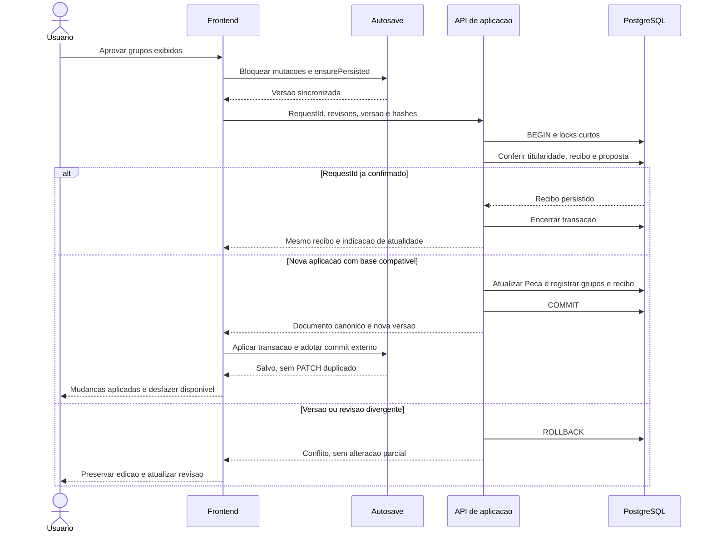
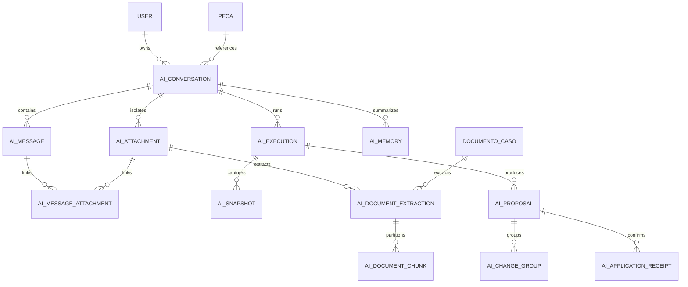

# Diagramas do detalhamento técnico

> Proposta, 2026-11-11. Representações em Mermaid, mantidas no repositório.
> Complementam as especificações; não representam serviços já implementados.

## Componentes e fronteira de escrita

O modelo não tem ligação de escrita com a Peça. Consulta histórica pessoal usa
rota própria, sem passar pelo worker, modelo ou consulta ao Caso atual.

## Aprovação e conflito

Se a resposta se perder, o frontend consulta o recibo com o mesmo requestId.
Um recibo antigo não autoriza sobrescrever uma Peça que já avançou de versão.

## Relações centrais de conteúdo

A extração tem origem exclusiva: anexo privado **ou** DocumentoCaso, nunca ambos.
A FK da Peça para conversas não implica exclusão em cascata. Organização e
titularidade continuam nos filtros e constraints descritos na especificação de
dados; este diagrama omite colunas e tabelas operacionais para facilitar leitura.
